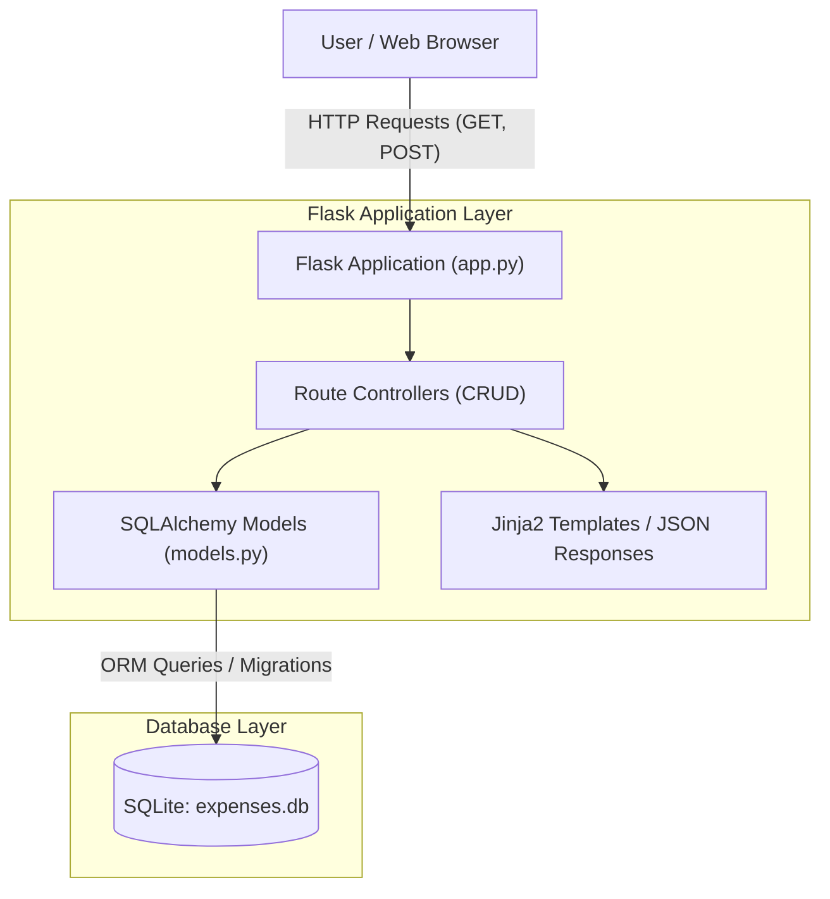
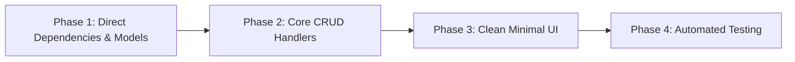

# Minimal Flask Expense Tracker — Architecture & Implementation Plan

This document outlines the architecture, database schema, route specifications, and phased implementation roadmap for the Flask Expense Tracker.

---

## 1. Scope & Requirements Checklist

- [x] **Full CRUD Operations**:
  - **Create**: Add new expense with validation (title, positive amount, category, optional description).
  - **Read**: Display all expenses, individual expense details, and total spending summaries.
  - **Update**: Edit existing expense values with automatic `updated_at` refresh.
  - **Delete**: Safely delete expenses with confirmation.
- [x] **Data Attributes**:
  - `id` (Integer, Primary Key)
  - `title` (String, required)
  - `amount` (Numeric/Float, positive, required)
  - `category` (String, e.g., Food & Dining, Transportation, Utilities, Entertainment, Healthcare, General)
  - `description` (Text/String, optional additional notes)
  - `created_at` (DateTime, UTC timestamp at creation)
  - `updated_at` (DateTime, UTC timestamp, auto-updated on change)
- [x] **Storage & ORM**:
  - SQLite database (`expenses.db`)
  - Flask-SQLAlchemy ORM
- [x] **Environment & Dependency Strategy**:
  - **No virtual environment**: Directly use your current/system Python installation without creating a `.venv` directory.
  - Dependencies installed directly via `pip install -r requirements.txt`.

---

## 2. System Architecture



---

## 3. Database Schema

The `Expense` model is mapped to SQLite via SQLAlchemy:

| Column | Type | Constraints | Description |
| :--- | :--- | :--- | :--- |
| `id` | `Integer` | Primary Key, Autoincrement | Unique identifier |
| `title` | `String(120)` | `nullable=False` | Short description of expense |
| `amount` | `Float` | `nullable=False` | Expense cost (enforced `> 0`) |
| `category` | `String(50)` | `nullable=False`, `default='General'` | Category classification |
| `description` | `Text` | `nullable=True` | Optional extra details or notes |
| `created_at` | `DateTime` | `nullable=False`, `default=datetime.utcnow` | Timestamp when created |
| `updated_at` | `DateTime` | `nullable=False`, `default=datetime.utcnow`, `onupdate=datetime.utcnow` | Timestamp of last modification |

---

## 4. Project Structure (Root Directory & No Virtual Environment)

```text
Gemini-Projects/
├── app.py               # Flask app factory, configuration, and CRUD routes
├── models.py            # SQLAlchemy database setup and Expense model
├── static/
│   └── css/
│       └── style.css    # Clean, modern, minimal styling (responsive card UI)
├── templates/
│   ├── base.html        # Shared base layout (navigation, flash messages)
│   ├── index.html       # Dashboard: total summary, expense table, quick-add form
│   └── edit.html        # Edit expense form
├── requirements.txt     # Flask, Flask-SQLAlchemy (installed directly)
├── README.md            # Usage and direct execution instructions
├── PLANNING.md          # Architecture and design plan
└── tests/
    └── test_crud.py     # Automated tests for CRUD operations and validations
```

---

## 5. Endpoints & Route Specifications

Interactive web views paired with JSON API endpoints:

| Method | Endpoint | Description | Response Type |
| :--- | :--- | :--- | :--- |
| `GET` | `/` | Dashboard showing all expenses, category breakdown, search & filter, and total sum | HTML (`index.html`) |
| `POST` | `/expenses/new` | Create a new expense via web form | Redirect to `/` |
| `GET` | `/expenses/<id>/edit` | Render the edit form for a specific expense | HTML (`edit.html`) |
| `POST` | `/expenses/<id>/edit` | Update an existing expense | Redirect to `/` |
| `POST` | `/expenses/<id>/delete` | Delete an expense | Redirect to `/` |
| `GET` | `/api/expenses` | Retrieve all expenses and summary statistics as JSON | `application/json` |
| `POST` | `/api/expenses` | Create a new expense via JSON payload | `application/json` |
| `GET` | `/api/expenses/<id>` | Retrieve a single expense by ID as JSON | `application/json` |
| `PUT` | `/api/expenses/<id>` | Update an expense by ID via JSON | `application/json` |
| `DELETE` | `/api/expenses/<id>` | Delete an expense by ID via JSON | `application/json` |

---

## 6. Phased Implementation Roadmap



### Phase 1: Direct Dependencies & Data Models
1. Provide `requirements.txt` containing `Flask` and `Flask-SQLAlchemy`.
2. Install packages directly into the active Python environment using `pip install -r requirements.txt` (without creating a virtual environment).
3. Set up `models.py` with SQLAlchemy setup, `Expense` class, and timestamp handling.

### Phase 2: Core Application & CRUD Routing
1. Configure `app.py` with SQLite database connection (`expenses.db`).
2. Implement CRUD handlers:
   - Input validation (positive numeric amount, non-empty title).
   - Safe category fallback.
   - Optional `description` support.
3. Flash notification banners for feedback.

### Phase 3: Minimalist Frontend UI
1. `base.html`: Modern, clean layout with responsive navigation and flash alerts.
2. `index.html`: Dashboard with metric cards (Total Spent, Count, Filtered Sum), quick-add form, category filter, and search.
3. `edit.html`: Form to edit expense values and inspect created/updated timestamps.
4. `style.css`: Clean modern typography, category badges, and responsive tables.

### Phase 4: Automated Verification & Direct Execution
1. Run `test_crud.py` directly using `python -m unittest tests/test_crud.py`.
2. Start the web application with direct `python app.py`.
